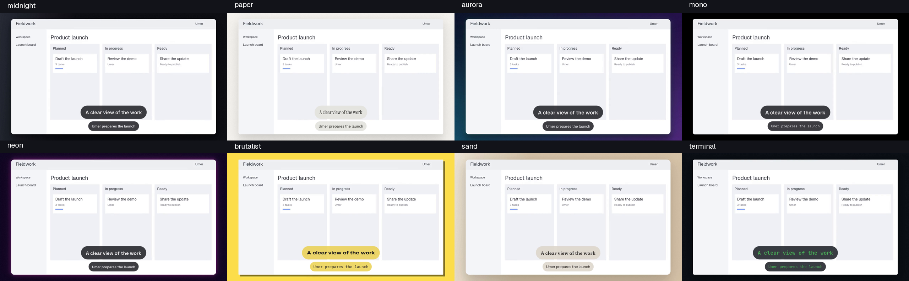

# Look and pacing

Every recording render uses the same stage, all local ffmpeg/libass work at zero token cost:

- **Stage**: the default screen card sits on a near-black stage lit by a soft glow of the accent's hue, with fine grain, rounded corners and a soft 40 px shadow. The selected theme sets these same shared tokens, background, and typography; see the theme preview below. The stage margin (`stage_margin`, fraction of stage size) eases away as the camera zooms, so close-ups are all screen. When the text band described below is active, the card stays fixed and the camera zooms inside it.
- **Device frame**: `--frame browser|laptop|phone|none` (or `--set frame=...`) puts the recording in a browser window (title bar, traffic lights, address pill, and a shadow cast from the bar), a laptop (bezel and base) or a handset; the same names are `takeone motion --device`. The default `auto` frames a phone take in its handset and leaves other takes bare. The chrome sits in the stage margin behind the screen, so app pixels and pointer coordinates are unchanged, and it eases away as the camera pushes in.
- **Zoom**: shots never upscale source pixels more than `max_upscale` (1.0 by default): a 4K capture can push into native 1080p detail; a 1080p capture exported at 1080p stays wide. Upscaling remains an explicit setting. A value below 1 keeps a HiDPI capture wide (0.5 holds a 2× capture at its rest framing). The camera path runs through a critically damped spring (`lowpass_omega`), so moves ease in and out without overshoot. A move that zooms and pans is a zoom about the two views' shared fixed point, and the spring eases the crop's edges and width alike, so the page edge never turns back mid-move. A pan back the way the page last moved, a result reveal included, and the outro each start only after the view has rested `min_shot`. A shot whose screen a cut brings in still arrives on time: the new screen replaces the page. See [Plan and render](guide.md#plan-and-render) for whole-element framing and static UI detection. Per-level padding never widens a shot past `frame_max` (0.8) of the screen, and the zone itself always keeps `hold_pad` (1.08x) around it.
- **Camera path**: the default `solver` chooses each shot; `--set camera_path=hold` instead keeps the solver's settled framings, checked on the frame actually shown, holds each one, and joins them with single eased moves, widening any hold that would clip its subject. `camera-holds.json` beside `camera.json` lists each hold and why. See [edit controls](edit-controls.md).
- **Bookends**: the whole stage holds until the first move, at least `establish_s` in (shortened, to no less than half of it, when that is what lets the first push-in land by the first click), and the camera eases back to the whole stage before the final `outro_s`, but never before the last shot has landed and held for `min_shot` (0 keeps the last shot and still ends on the last activity). The video fades in from and out to `background_to` over `fade_s`.
- **Clicks**: every click and drag press gets a thin translucent expanding `accent` ring with a faint white halo and no filled press dot, lasting `ripple_ms` (0 turns it off) and growing to `ripple_r` output px at rest, clamped so the full ring stays inside the frame (edge presses with too little room are skipped). The ripple is drawn in source space, so it zooms with the content.
- **Cursor**: desktop captures are cursor-free when the engine can hide the system cursor; takeone draws a vector cursor from the recorded pointer track, with cosine-eased smoothing and gentle square-root zoom scaling. Every click lands the arrow's tip exactly on its ripple. `cursor_size` scales it (1 is a 48 px arrow at 1080p; 0.5 to 3, where 0.5 is the system cursor's own size). `cursor_hide_idle_s` is the stillness, in seconds, before it fades out over half a second (1.8 by default; 0 never hides it). `cursor_loop=1` glides it back to where it started over the final 0.8 s, after the last click, so a film that loops (for example with `fade_s=0`) has no cursor jump. A source that keeps its system cursor renders as before and ignores these settings.
- **Pacing**: idle stretches between actions play `idle_speed` times faster (1 turns it off), keeping `idle_keep` seconds of real time around every action. The camera is solved on the output clock, so moves keep their natural speed. A single untimed `speed` entry `{ "kind": "type_speed", "rate": 3 }` in `take.json` speeds every detected typing burst, and timed `speed` regions set an explicit playback rate from 0.1 to 16; see [edit controls](edit-controls.md).
- **Shortcut keycaps and regions**: validated Ctrl/Alt/Meta shortcuts display as keycap pills. Timed `spotlight` and `blur` rectangles in `take.json` follow source pixels through camera motion. See [recording overlays](overlays.md) for the schema and a synthetic proof generator.
- **Titles and captions**: in every export shape, optional `title` and `captions` in `take.json` render in the band below the card, never over the app: the title as bare display type 1.125× `caption_size`, captions as single-line pills in the caption font that shrink to fit rather than wrap. Text size, row padding and caption border scale down proportionally when needed to keep the band within a third of the output height (a tenth on portrait), so the card keeps over 55% of a square frame's width and 80% of a portrait frame's. Captions keep their original timestamps, and each caption ends when the next one starts if they overlap. When a title and caption are on screen together, they occupy separate measured rows in the band below the card. The card takes the export's shape, so a 16:9 screen exported portrait, square or 4:5 is cropped to fill it and the camera moves inside it; a screen narrower than the export (a phone take, or a portrait screen in a 16:9 film) shows whole in a card of its own shape, a phone in its handset. Caption times are source-video seconds; `d` (default 3) is on-screen seconds, so reading time survives idle squeezing.

```json
{ "title": "Find any report in seconds",
  "captions": [{ "t": 8.4, "text": "Search filters as you type" }, { "t": 22.6, "d": 3.6, "text": "Drag to adjust retention" }] }
```

Both `make` and recording `render` accept `--theme NAME`; the supported names are defined in [the shared theme registry](../src/themes.ts), including the new `editorial` theme.
`midnight` is the default near-black glow look, unless the AI film call picks a theme (see [Plan and render](guide.md#plan-and-render)). A saved `"theme": "paper"`
in `take.json` applies on every rerender; an explicit `--theme` takes precedence,
and `--set` overrides the selected theme's tokens. `make --theme` saves the
selection in the take; `render --theme` previews a different look without
changing that saved selection.




Theme fonts are bundled under OFL 1.1 with their licence files in
`resources/fonts/`. Caption measurement and final rendering use the same
libass `fontsdir`; `render.log` records the selected faces. A custom font that
is neither installed nor bundled may be substituted through fontconfig.

Colours (`background`, `background_to`, `accent`, `text`, `card`) take
`--set key=#RRGGBB`. `caption_font` and `display_font` take letters, digits and
spaces, for example `--set "display_font=Inter Bold"`.

Additional look tokens: `bg_style=linear|solid|radial|mesh|image`,
`bg_stops=#RRGGBB,#RRGGBB,...` (2–8 colours), `grain=0..100`,
`shadow_blur`, `shadow_x`, `shadow_y`, `shadow_color`, `border`, `border_color`, `glow=0..1`,
`bg_pattern=none|grid|scanlines`, `caption_rounding=0..1`,
`caption_opacity=0..1`, `caption_border=0..16`,
`spring_omega`, `spring_zeta=0.75..2`, and `pace=0.25..4`.
For `bg_style=image`, supply `background_image=/path/to/image.png` (relative
paths resolve inside the take). Recording backgrounds are deterministic stills;
animated background drift and per-theme motion patterns belong to motion scenes.
Linear, radial and mesh stages are generated in 8 bits with an independent ±2 level
triangular dither per channel, held over 2×2 output pixels so 4:2:0 chroma keeps it:
a hue ramp otherwise bands in chroma, which a luma-only CAMBI check never sees.
Overlay spring tokens adjust caption arrival time only; the recording camera
remains critically damped. Recording `pace` scales camera holds (`dwell`,
`dwell_k2`, `min_shot`) while keeping move durations and caption reading time.

The committed theme preview assets are historical real-take stills at 1080p60: one full-resolution frame per theme in the grid above. They predate the near-black midnight default and are not current-candidate acceptance evidence. [Provenance](assets/themes/provenance.json)
records the source take, generator, proof status per theme and output hashes.
That historical qualification covered midnight, paper, aurora, mono, sand and editorial on the real take: worst fade CAMBI 0.279 (mono) and worst
whole-take CAMBI 0.043, measured on every frame of both fade windows.
`neon`, `brutalist` and `terminal` (cut in #71, restored here) are not in that grid or its CAMBI figures; they were rendered on the real board take and checked by eye at settled and fade frames only.
Regenerate with `node scripts/theme-proof.ts tmp/theme-proof`.
For a real 1080p60 take, use `node scripts/theme-proof.ts tmp/theme-real --take path/to/take`;
each theme shows its title above a caption frame. The synthetic fixture is a fictional
Tidewater launch board with Umer as its demo person, with no desktop capture.
The captured 2560×1440 fixture comes from `scripts/e2e/scene.html`; the proof
uses `stage_margin=0.16` so background treatment is visible at thumbnail size.
Every theme meets 4.5:1 caption contrast, including compositing over a white
or black screen. Paper uses opaque cream labels and black ink.

For a repeatable ten-second framing proof, capture `scripts/e2e/scene.html` at 2560×1440 CSS pixels with device scale 1.5 into `tmp/frame-proof/scene.png` with `chrome-devtools-axi`, then run `node scripts/e2e/frame-proof.ts`. It uses the scene’s measured boundary fixtures through zone generation and the real renderer, writing the MP4, a held-shot still, and `camera-quality.json` with the clipped fraction of each UI box at every settled frame.

For the static-boundary proof, run `bash scripts/e2e/uiboxes-record.sh`; it is a heavy encode, so run heavy jobs one at a time on a shared machine. It needs Xvfb, Chromium, `chrome-devtools-axi`, and the installed recording engine. It allocates an isolated 2560×1440 virtual display and empty browser profile, records the real Tidewater scene through `takeone capture record`, and supplies only demo-browser input events. The fixture prevents cards from toggling or dragging so clicks exercise unchanged surfaces, then opens the real New task dialog. `uiboxes-proof.ts` runs the shared planner/camera/render core and compares the same footage with static hints omitted. Actual change regions around all four proof clicks must be empty; scene geometry checks the output crops and never supplies the detector. Before/after MP4s, contact sheets, source recording, recorder metadata and an analysis-cost/held-shot receipt are written flat under `tmp/evidence/uiboxes/` with the `takeone-uiboxes-` prefix. See [Plan and render](guide.md#plan-and-render) for static-analysis bounds and cost reporting; the existing zone vocabulary and shared Jev budget remain unchanged. The BYOKit package catalog checked on 2026-10-01 supplies planning and secrets but has no recording-frame boundary detector; this product-specific UI framing pass remains local to TakeOne.

Back to the [README](../README.md).
